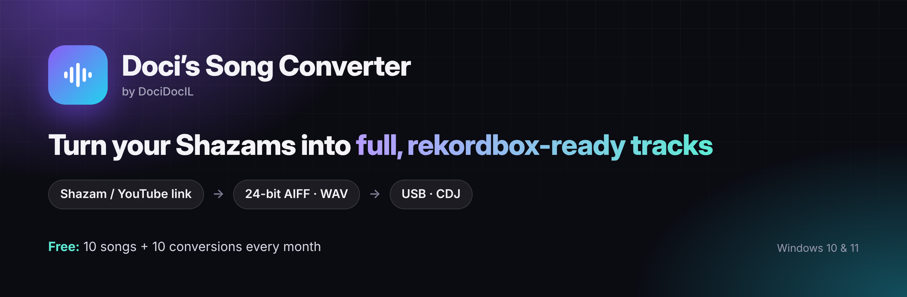

<!--
  Before you publish this repo, replace the two placeholders below everywhere they appear:
    YOUR_BOT        -> your Telegram bot username, e.g. docis_converter_bot   (no @)
    YOUR_USER       -> your GitHub username (only used in the Releases link)
  And upload banner.png to the repo root (same folder as this README).
-->

<p align="center">
  
</p>

<p align="center">
  <b>Turn your Shazams and YouTube links into full, rekordbox-ready songs — in one click.</b><br>
  24-bit AIFF / WAV for Pioneer CDJs. Made for DJs.
</p>

<p align="center">
  
  
  
  
</p>

<p align="center">
  <a href="https://dsc-server.ulticonvert.workers.dev/download">
    
  </a>
  &nbsp;
  <a href="https://t.me/ShazamYoutubeYTConvert_bot">
    
  </a>
</p>

---

## What it does

You collect Shazams on your phone all night. The next day, getting them into rekordbox as real, playable files is slow. **Doci's Song Converter** does it for you: paste the links, and it finds each full song and saves it as a clean 24-bit AIFF or WAV with the title, artist and artwork — ready to drag into rekordbox and drop on a USB stick for your CDJs.

It runs on your own PC, so your downloads come from your own connection.

## Shazam → rekordbox in 5 steps

1. In Shazam, open a song → **Share** → copy the link. Collect as many as you like.
2. Paste all the links into the app. It finds each full song automatically.
3. Choose **Full song** + **Rekordbox / CDJ**, then click **Download**.
4. Drag the files into rekordbox (Export mode) and let it analyze them.
5. Drag the tracks or playlist onto your USB stick → plug into your CDJ / XDJ.

> YouTube links work too. There's also a **Converter** tab that turns files you already bought (MP3, M4A, FLAC, WAV, ZIPs…) into rekordbox-ready AIFF.

## Why DJs like it

- 🎧 **Made for Pioneer gear** — 24-bit AIFF with tags and artwork that rekordbox reads.
- ⚡ **Batch everything** — paste a whole night of Shazams at once; up to 3 download together.
- 🏷️ **Clean files** — correct title, artist and cover, named properly.
- 🔁 **Converter built in** — fix up purchases and odd formats into one consistent library.
- 💻 **Your PC, your connection** — nothing is streamed through a server.
- 🆓 **Free to start** — 10 full songs + 10 conversions every month, no account.

## Formats & quality

| Format | Best for | Notes |
|---|---|---|
| **AIFF** | rekordbox & CDJs | Uncompressed, full tags **and artwork** |
| **WAV** | Max compatibility | Same audio, fewer tags |
| **MP3** | Small files | 320 kbps with tags |

Default is **24-bit · 44.1 kHz**, which plays on every Pioneer player. YouTube audio is compressed, so a file can't sound better than its source — for club play, buy the lossless track (each row links you to Beatport, Traxsource, Bandcamp and Apple, plus free artist downloads).

## Pricing

- **Free** — 10 downloads + 10 conversions every month. No sign-up.
- **Pro** — **$4.99 / month** or **$39.99 / year**, paid in crypto inside the app. One PC per license. No automatic renewal — you pay again only if you want to.

## Download

**[⬇ Download the latest version](https://dsc-server.ulticonvert.workers.dev/download)** — always the newest build.

Or grab it from [Releases](https://github.com/DociDoc420/Doci-s-Shazam-WAV-MP3-YT-Converter/releases/latest).

> **"Windows protected your PC"?** That shows for any new app from a small developer. Click **More info → Run anyway**. The app is safe (see below).

## Is it safe?

- The installer is scanned on **[VirusTotal](https://www.virustotal.com/gui/file/cdb481517f721d29906b877cf53010358457ea91ffd13b5e772ab8537ac3e332/detection)**.
- It installs for your user only, changes no system settings, and contains no ads, miners or bundled software.
- Verify your download's fingerprint (SHA-256):

  ```
  cdb481517f721d29906b877cf53010358457ea91ffd13b5e772ab8537ac3e332
  ```
  ```powershell
  Get-FileHash .\DocisSongConverter-Setup.exe -Algorithm SHA256
  ```

A few security engines flag new, unsigned installers out of caution — that's a false positive, common for indie software.

## Support

Questions, a new PC, or a payment issue? Message the bot — we reply in the chat:

**→ [https://t.me/ShazamYoutubeYTConvert_bot](https://t.me/ShazamYoutubeYTConvert_bot)**

## Legal

Doci's Song Converter is a tool. You are responsible for what you download and for respecting the rights of creators and the terms of the services you use. See the in-app **Terms of Use** and **[Privacy Policy](https://dsc-server.ulticonvert.workers.dev/privacy)**.

Not affiliated with Apple, Shazam, YouTube, Pioneer DJ, AlphaTheta or rekordbox. All trademarks belong to their owners.

<p align="center"><sub>© 2026 DociDocIL · Windows 10 & 11</sub></p>
